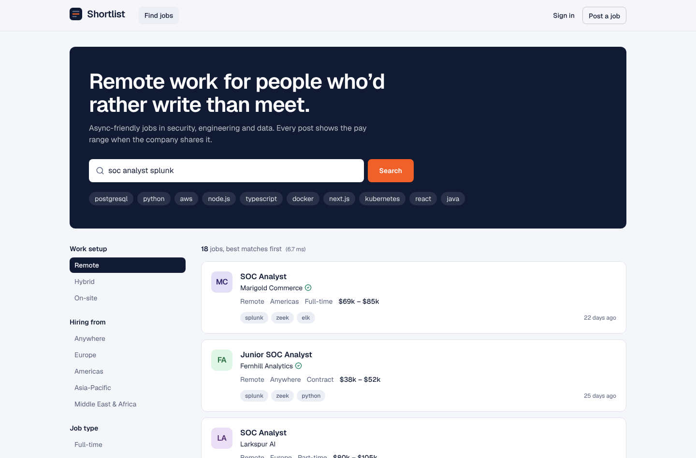
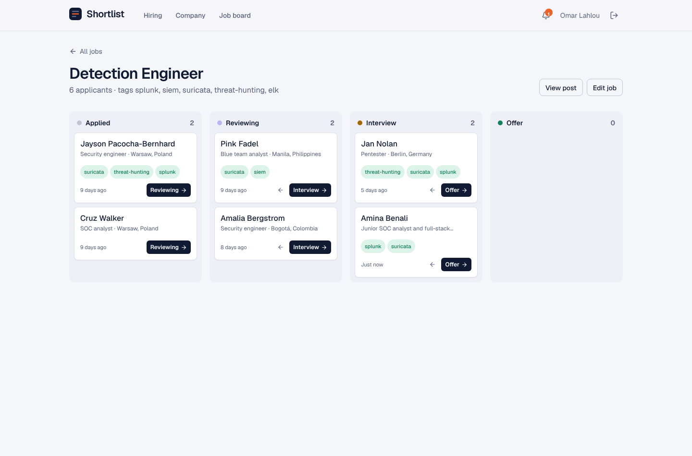
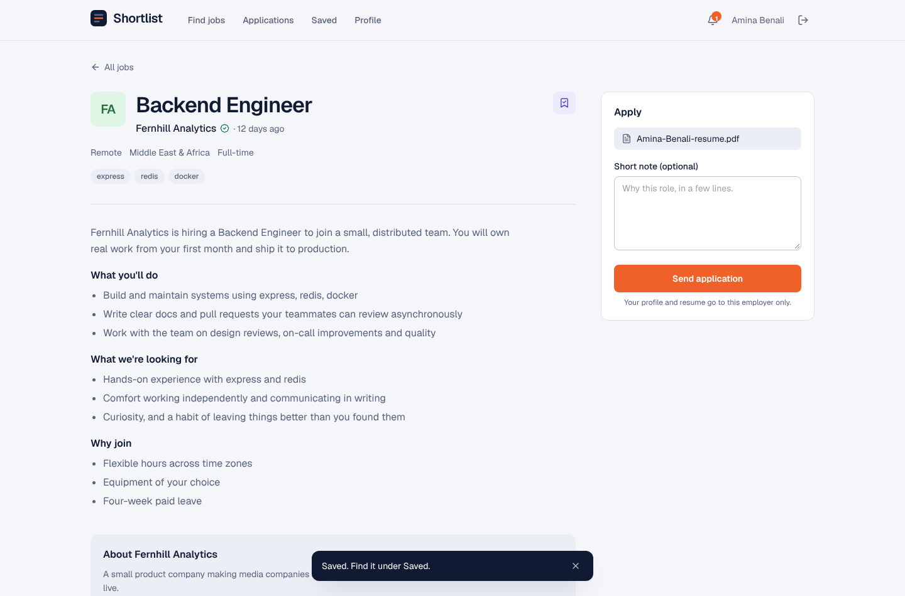
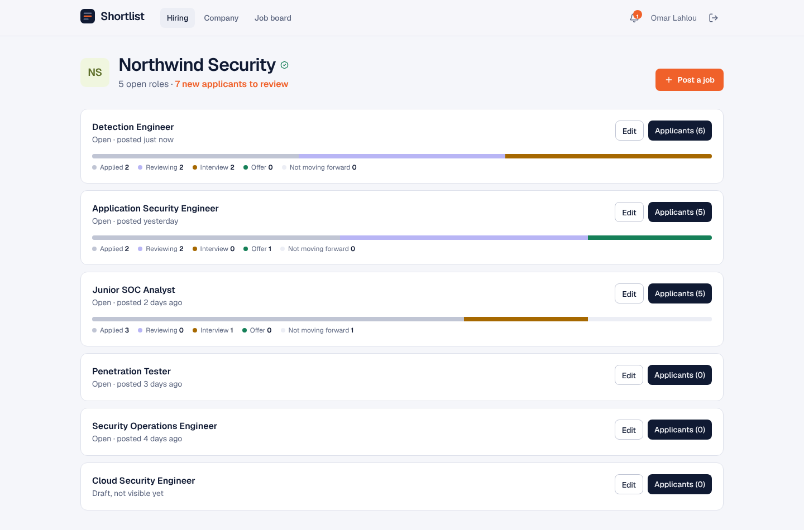
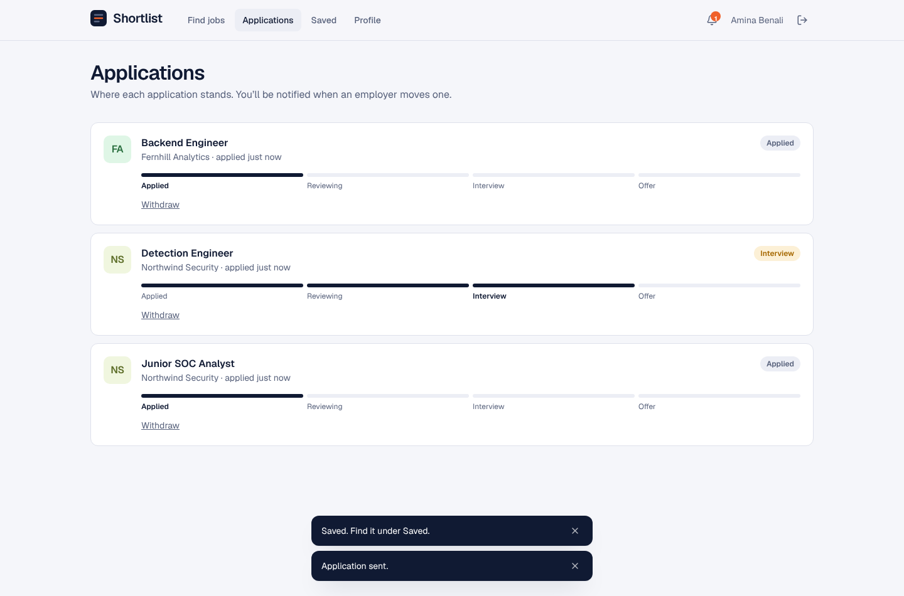
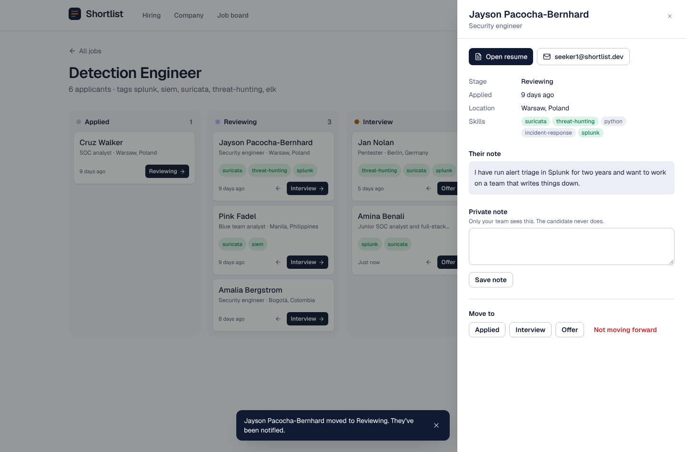
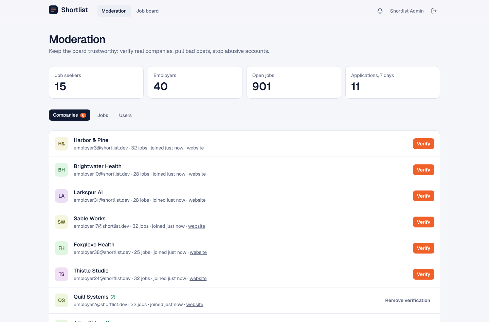

# Shortlist

A job board for **remote and async-friendly roles**, with three sides: job seekers search and apply, employers run a hiring pipeline, and admins keep the board trustworthy.

Built for the **Auspify Technologies Full Stack Development Internship, Task 5 (Job Portal)**.



**Live demo:** _add your Vercel link here_ · All demo accounts use the password `Shortlist!2026`: `seeker@shortlist.dev`, `employer@shortlist.dev`, `admin@shortlist.dev`

## Features

**Job seekers**
- Full-text search with ranking (title matches beat description mentions). Filters for work setup, region, job type, minimum pay, skill tag and posting date, all kept in the URL.
- A profile with headline, skills and region, plus a **private PDF resume** (5 MB maximum, checked by file signature).
- One-click apply with an optional note, bookmarking saved jobs, and an applications page showing each job's progress through the pipeline.
- In-app notifications when an employer moves your application.

**Employers**
- A company profile, and a job editor with draft, publish and close states, pay range validation and skill tags.
- **Hiring board:** one column per stage (Applied, Reviewing, Interview, Offer). Cards move instantly and the candidate is notified. Each card shows which skills match the job.
- An applicant drawer with the resume (opened through an access check), the candidate's note, and a **private team note the candidate never sees**.

**Admins**
- Counts by role, open jobs and weekly applications.
- Verify companies, hide job posts (the employer is told), and suspend accounts. A suspension locks the account out immediately, even with a valid session.

| | |
| --- | --- |
|  |  |
|  |  |
|  |  |

## Database optimization (the full-text search)

Each job stores a weighted `tsvector` (title A, tags B, description C) in a column with a **GIN index**. Search uses `websearch_to_tsquery` and ranks with `ts_rank_cd`. Tags have their own GIN index for `@>` filters, and `(status, published_at)` has a B-tree index for the default newest-first list.

On the 1,000 seeded jobs, `EXPLAIN ANALYZE` for "soc analyst splunk" gives: **Execution Time: 1.349 ms** (Seq Scan on jobs). An automated test checks that a search over 1,000+ jobs answers in **under 100 ms**, and the API returns the time it took (`meta.tookMs`), which the results page shows.

## Stack

| Layer | Choice |
| --- | --- |
| Frontend | React 19, Vite, TypeScript, Tailwind CSS, TanStack Query (optimistic board moves), React Hook Form, Radix UI |
| Backend | Node.js 20, Express 5, TypeScript |
| Database | PostgreSQL full-text search, GIN indexes, Drizzle ORM |
| Files | Resumes stored as `bytea` and only served through ownership checks |
| Auth | argon2, JWT in an httpOnly cookie, role and suspension re-read from the database on every request |
| Tests | Vitest + Supertest (15 API tests), GitHub Actions CI |

## Run it locally

```bash
npm install
cp server/.env.example server/.env    # set DATABASE_URL and JWT_SECRET
npm run db:migrate
npm run db:seed                        # 1,000 jobs, 40 companies, demo accounts
npm run dev                            # API :4000, app http://localhost:5173
```

## API

| Method | Route | Who |
| --- | --- | --- |
| GET | `/api/jobs?q=&remote=&type=&region=&salary=&tag=&since=&page=`, `/api/jobs/:id`, `/api/tags`, `/api/companies/:slug` | Anyone |
| GET / PUT | `/api/me/profile`, `/api/me/resume` (raw PDF body) | Seeker |
| POST | `/api/me/jobs/:jobId/apply` | Seeker |
| GET / DELETE | `/api/me/applications[/:id]` | Seeker (own only) |
| GET / PUT / DELETE | `/api/me/saved[/:jobId]` | Seeker |
| GET / PUT | `/api/employer/company` | Employer |
| GET / POST / PUT / DELETE | `/api/employer/jobs[/:id]` | Employer (own company only) |
| GET | `/api/employer/jobs/:id/applicants`, `/api/employer/applications/:id/resume` | Employer (own jobs only) |
| PATCH | `/api/employer/applications/:id` | Employer: stage and private note |
| GET / PUT | `/api/admin/stats`, `/companies[/:id/verified]`, `/jobs[/:id/hidden]`, `/users[/:id/suspended]` | Admin |
| GET / POST | `/api/notifications`, `/api/notifications/read` | Anyone signed in |

## Deploy

Neon Postgres (full-text search works on it as is), API on Render (`render.yaml`), app on Vercel with root `client` and `VITE_API_URL` set.

See [SECURITY.md](SECURITY.md).

---

Built by M'hammed Mazin · [github.com/Mazine01](https://github.com/Mazine01) · #Auspify #AuspifyInternship
